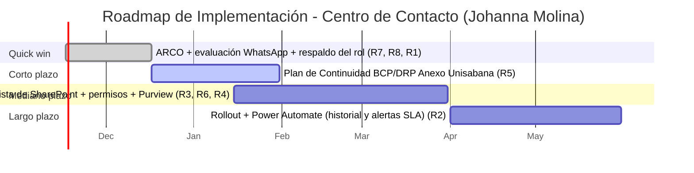

# Plan de Implementación (Roadmap de Transición)

## Cliente
Centro de Contacto (Contact Center) — Universidad de La Sabana. Contacto: Johanna Andrea Molina.

## Integrantes del equipo
- Nicolas Esteban Muñoz Sendoya (nico9ms@hotmail.com — GitHub: N1kxo)
- Juan David Orozco Rodríguez (davidorozcoj1@gmail.com — GitHub: DavidOrozcoJ)

## Propósito de este documento
La solución del Taller 7 (migrar el Consolidado de Casos a una Lista de SharePoint con historial y permisos por rol, automatizar alertas de SLA con Power Automate, y cerrar las brechas de continuidad y cumplimiento normativo) no se implementa de un día para otro. Entregar solo el diseño TO-BE dejaría a Johanna con la misma pregunta que tenía al iniciar el curso: "¿y ahora cómo lo hago, con el equipo y el tiempo que realmente tengo?". Este plan traduce esa solución en 4 fases ejecutables, cada una trazada a un riesgo real de `matriz-riesgos.xlsx`.

## Fases de implementación

| Fase | Qué se implementa | Riesgo / brecha que corrige | Esfuerzo | Duración estimada | Responsable sugerido |
|---|---|---|---|---|---|
| Quick win | Paquete de cumplimiento normativo (WP3, Taller 7): procedimiento ARCO documentado, evaluación de la transferencia internacional vía WhatsApp Business y política de retención/TRD; además, manual de respaldo del rol de gestor de casos | R7 (incumplimiento normativo parcial), R8 (transferencia internacional vía WhatsApp), R1 (dependencia de una sola persona) | Bajo | 0–1 mes | Johanna Molina (Supervisora) / Legal / Protección de Datos de la Universidad |
| Corto plazo | Plan de Continuidad (BCP/DRP) para el Servidor Anexo Unisabana: respaldo y procedimiento de recuperación documentado (WP2, Taller 7) | R5 (punto único de falla, infraestructura) | Medio | 1–2 meses | Dirección de Tecnología / Equipo TI institucional |
| Mediano plazo | Piloto y configuración de la Lista de SharePoint — Consolidado PQRSF: migración de los campos del Excel actual, permisos por rol/columna, políticas DLP de Microsoft Purview (primera mitad del WP1, Taller 7) | R3 (falta de trazabilidad), R6 (exposición de datos personales), R4 (deuda de integración Anexo Unisabana/Excel) | Alto | 2–4 meses | Equipo de arquitectura (Nicolás / Juan David) junto con Alexander (Gestor de Casos) |
| Largo plazo | Rollout completo de la Lista de SharePoint + automatización con Power Automate (registro automático en el historial de auditoría y alertas tempranas de SLA) + cierre de la doble transcripción manual (segunda mitad del WP1, Taller 7) | R2 (doble registro manual, procesos) | Alto | 4–6 meses | Dirección de Tecnología / Centro de Contacto |

> **Por qué en este orden y no por prioridad de riesgo.** R2 y R3 son los riesgos de mayor nivel (Crítico, prioridad 1 en la matriz), pero ambos se cierran con la misma intervención de mayor esfuerzo (la migración completa a SharePoint, WP1), así que no pueden ser el quick win — se dividió en dos fases (Mediano y Largo plazo) para no bloquear el resto del roadmap detrás de la fase más compleja. El quick win se reservó para lo de menor esfuerzo y mayor urgencia de cumplimiento (R7 y R8, Ley 1581 y Decreto 1377) y para una acción puramente documental que reduce un riesgo de negocio (R1) sin esperar ningún desarrollo técnico — la misma lógica que usa el ejemplo de FarmApp en la guía del taller.
>
> R1, R7 y R8 comparten la fase Quick win porque sus mitigaciones son documentales (no requieren configurar ningún sistema) y pueden avanzar en paralelo con los mismos responsables (Johanna y el equipo de arquitectura).

## Línea de tiempo

## Dependencias entre fases
- La fase **Mediano plazo** depende de que la Dirección de Tecnología confirme el licenciamiento de Microsoft 365 institucional habilitado para Microsoft Purview (DLP), porque sin esa licencia no se puede cerrar R6 junto con R3.
- La fase **Largo plazo** depende de que la fase **Mediano plazo** haya cerrado la migración de datos y permisos: automatizar alertas de SLA sobre un consolidado que todavía está en Excel repetiría el mismo problema de doble fuente de verdad.
- La fase **Corto plazo** (BCP/DRP del servidor) es independiente de las otras tres y puede ejecutarse en paralelo, porque corrige un riesgo distinto (infraestructura) con un responsable distinto (TI institucional, no el equipo de arquitectura ni el Centro de Contacto).

## Gestión del cambio con las personas

| Grupo | Qué pierde o teme | Resistencia esperada | Poder / interés | Comunicación y capacitación | Cuándo | Responsable |
|---|---|---|---|---|---|---|
| Alexander (Gestor de Casos) | Que la trazabilidad lo haga más visible/responsable de cada demora, al quedar registrado quién hizo cada cambio y cuándo | Seguir editando el Excel "a la antigua" en paralelo a la Lista de SharePoint, por costumbre | Bajo / Alto | Explicarle que el historial lo protege (muestra el flujo completo, no solo apunta culpas) + capacitación de 1 hora en el uso de la Lista de SharePoint | Antes de la fase Mediano plazo | Johanna Molina (Supervisora) |
| Johanna Molina (Supervisora) | Depender de un flujo de Power Automate que ella debe supervisar, sin tener antes experiencia administrándolo | Aprobar el diseño pero posponer la activación de las alertas por falta de tiempo para aprenderlo | Alto / Alto | Taller de 2 horas sobre el tablero de reportes automáticos y las alertas de SLA, antes de activarlas en producción | Antes de la fase Largo plazo | Equipo de arquitectura (Nicolás / Juan David) |
| Facultades / Unidad Responsable (atienden Nivel 2 y 3) | Un paso adicional de notificación automática que no estaba antes en su flujo de correo/Teams | Ignorar las notificaciones de Power Automate igual que hoy a veces se ignora el correo de Alexander | Medio / Medio | Correo institucional + instructivo de una página sobre cómo llega y qué significa la nueva alerta | Antes de la fase Largo plazo | Johanna Molina / Centro de Contacto |
| Dirección de Tecnología (TI institucional) | Sumar un componente más (Power Automate, Purview) a soportar, sin presupuesto ni dotación de personal nueva | Retrasar la aprobación de licenciamiento o del BCP/DRP por carga de trabajo propia | Alto / Alto | Incluirlos desde la ADR #1 (`procedimiento-cambios.md`) como parte interesada, y capacitarlos en el mantenimiento básico del flujo | Desde la fase Quick win | Johanna Molina (como sponsor del proyecto ante TI) |

### Resultado visible por fase

| Fase | Resultado visible | Quién lo comprueba (fuera de TI) |
|---|---|---|
| Quick win | Existe un procedimiento ARCO documentado y publicado, una evaluación escrita del uso de WhatsApp Business, y un manual de respaldo del gestor de casos | Legal / Oficina de Protección de Datos de la Universidad |
| Corto plazo | El Servidor Anexo Unisabana tiene un plan de recuperación probado, con RTO/RPO documentados | Johanna Molina, revisando el documento del plan |
| Mediano plazo | Un caso registrado en la Lista de SharePoint muestra su historial de cambios completo (quién, cuándo, qué campo) | Johanna Molina, consultando el historial de un caso real |
| Largo plazo | Un ticket cercano a su fecha límite dispara una alerta **antes** de vencer, no se descubre el vencimiento después de pasado el SLA | Facultad / Unidad Responsable, confirmando que recibió la alerta a tiempo |

## Referencias
- The Open Group. *TOGAF Standard, 10th Edition — Phase E/F, Opportunities & Solutions / Migration Planning*. https://pubs.opengroup.org/togaf-standard/
- Kotter, J. P. (1996). *Leading Change*. Harvard Business School Press — base del criterio "un resultado visible por fase, comprobado fuera de TI".
- Documentos propios del equipo: `07-opportunities-solutions/mejora-arquitectura.md` y `matriz-brechas.xlsx` (Taller 7), fuente de los Work Packages WP1–WP3 que este roadmap secuencia en el tiempo.
- Fuente asistida por IA: Claude (Anthropic), noviembre 2026 — apoyo en la construcción del roadmap, la tabla de gestión del cambio y la redacción de este documento a partir exclusivamente del contenido real de los Talleres 0 a 8 del equipo.

---

_Este documento hace parte de la entrega final del Taller 9 del curso AREM (Arquitectura Empresarial) - Universidad de La Sabana._
