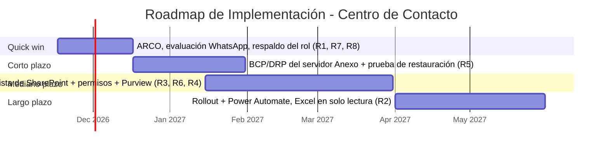

# Plan de Implementación (Roadmap de Transición)

## Cliente
Centro de Contacto (Contact Center) — Universidad de La Sabana.

## Integrantes del equipo
- Nicolas Esteban Muñoz Sendoya (GitHub: N1kxo)
- Juan David Orozco Rodríguez (GitHub: DavidOrozcoJ)

## Propósito de este documento
La solución del Taller 7 (migrar el Consolidado de Casos a una Lista de SharePoint con historial y permisos por rol, automatizar alertas de SLA con Power Automate, y cerrar las brechas de continuidad y cumplimiento normativo) no se implementa de un día para otro. Entregar solo el diseño TO-BE dejaría a la Supervisora del Centro de Contacto con la misma pregunta que tenía al iniciar el curso: "¿y ahora cómo lo hago, con el equipo y el tiempo que realmente tengo?". Este plan traduce esa solución en 4 fases ejecutables, cada una trazada a un riesgo real de `matriz-riesgos.xlsx`.

## Quién ejecuta el plan cuando termina el semestre
El equipo Innova2 diseña el plan pero no lo ejecuta: el curso termina con la sustentación del 14/11/2026 y la entrega del 17/11/2026, y el roadmap va de noviembre de 2026 a mayo de 2027. Por eso ningún integrante del equipo aparece como responsable de una fase. En la entrega del proyecto, el equipo deja a la Supervisora del Centro de Contacto y a la Dirección de Tecnología el repositorio completo (diagramas, matriz de riesgos, ADR y este plan) y se recomienda que la Dirección de Tecnología **designe un arquitecto o arquitecta de la solución** que asuma las tareas técnicas y la validación de conformidad descritas aquí y en `plan-gobernanza.md`.

## Fases de implementación

| Fase | Qué se implementa | Riesgo / brecha que corrige | Esfuerzo | Duración estimada | Responsable sugerido |
|---|---|---|---|---|---|
| Quick win | Paquete de cumplimiento normativo (WP3, Taller 7): procedimiento ARCO documentado, evaluación de la transferencia internacional vía WhatsApp Business y política de retención/TRD. Además: designar y entrenar a una persona de respaldo del rol de gestor de casos, y documentar roles y permisos de acceso por Unidad Responsable | R1 (dependencia de una sola persona), R7 (incumplimiento normativo parcial), R8 (transferencia internacional vía WhatsApp) | Bajo | 0–1 mes | Supervisora del Centro de Contacto, con el área jurídica / Protección de Datos de la Universidad |
| Corto plazo | Plan de Continuidad (BCP/DRP) para el Servidor Anexo Unisabana: respaldo, procedimiento de recuperación y **una prueba de restauración real** (WP2, Taller 7) | R5 (punto único de falla, infraestructura) | Medio | 1–2 meses | Dirección de Tecnología |
| Mediano plazo | **Piloto** de la Lista de SharePoint — Consolidado PQRSF: migración de los campos del Excel actual, permisos por rol/columna y políticas DLP de Microsoft Purview, con los casos nuevos de un canal. Durante el piloto el Excel sigue activo en paralelo (primera mitad del WP1, Taller 7) | R3 (falta de trazabilidad), R6 (exposición de datos personales), R4 (deuda de integración) | Alto | 2–4 meses | Arquitecto/a de la solución designado por la Dirección de Tecnología, con el Gestor de Casos |
| Largo plazo | Rollout de la Lista de SharePoint a todos los canales + automatización con Power Automate (registro automático en el historial de auditoría y alertas tempranas de SLA). El Excel deja de editarse y queda como archivo de solo lectura (segunda mitad del WP1, Taller 7) | R2 (doble registro manual, procesos) | Alto | 4–6 meses | Dirección de Tecnología, con el Centro de Contacto |

> **Por qué en este orden y no por prioridad de riesgo.** R1, R2 y R3 son los riesgos críticos de la matriz. R1 se puede atacar ya, con acciones documentales y de personas, por eso va en el quick win. R2 y R3 se cierran con la intervención de mayor esfuerzo (la migración a SharePoint, WP1), así que no pueden ser el quick win: se dividió en un piloto (Mediano plazo) y un rollout (Largo plazo) para no bloquear el resto del roadmap detrás de la fase más compleja. El quick win también reúne lo de mayor urgencia legal (R7 y R8, Ley 1581 y Decreto 1377), que es principalmente documental y no espera ningún desarrollo técnico.

### Cómo se reduce el doble registro (R2) si Anexo Unisabana se queda
Anexo Unisabana no exporta todos los campos y reemplazarlo quedó fuera del alcance acordado con el cliente (Taller 0, ADR #2). Por eso el doble registro **se reduce, no desaparece**:
- **Llamadas, WhatsApp y correo** (los canales sin integración): el Gestor de Casos los registra una sola vez, directamente en la Lista de SharePoint. Desaparece la transcripción a una segunda hoja.
- **Sitio web y app** (entran a Anexo Unisabana): en la Lista solo se registran el número de ticket de Anexo y los campos que Anexo no exporta. Ya no se copia el caso completo.
- **Lo que queda pendiente:** eliminar por completo esa segunda captura exigiría una exportación o integración desde Anexo Unisabana, que depende de la Dirección de Tecnología. Queda como riesgo residual de R2 y como disparador de cambio en `procedimiento-cambios.md`.

## Línea de tiempo

## Dependencias entre fases
- La fase **Mediano plazo** depende de que la Dirección de Tecnología confirme que el licenciamiento de Microsoft 365 institucional incluye Microsoft Purview (DLP), y de que designe al arquitecto o arquitecta de la solución.
- La fase **Largo plazo** depende de que el piloto haya validado la migración de datos y los permisos: automatizar alertas de SLA mientras el Excel sigue siendo fuente de datos repetiría el problema de las dos fuentes de verdad.
- La fase **Corto plazo** (BCP/DRP del servidor) es independiente de las otras tres y puede ejecutarse en paralelo, porque corrige un riesgo distinto (infraestructura) con un responsable distinto (Dirección de Tecnología).

## Gestión del cambio con las personas

| Grupo | Qué pierde o teme | Resistencia esperada | Poder / interés | Comunicación y capacitación | Cuándo | Responsable |
|---|---|---|---|---|---|---|
| Gestor de Casos | Que la trazabilidad lo haga más visible y responsable de cada demora, al quedar registrado quién hizo cada cambio y cuándo | Seguir editando el Excel en paralelo a la Lista de SharePoint, por costumbre | Bajo / Alto | Explicarle que el historial también lo protege (muestra todo el recorrido del caso, no solo errores) + capacitación de 1 hora en la Lista de SharePoint | Antes de la fase Mediano plazo | Supervisora del Centro de Contacto |
| Supervisora del Centro de Contacto | Depender de un flujo de Power Automate que debe supervisar sin experiencia previa administrándolo | Aprobar el diseño pero posponer la activación de las alertas por falta de tiempo para aprenderlo | Alto / Alto | Taller de 2 horas sobre los reportes y las alertas de SLA antes de activarlas en producción | Antes de la fase Largo plazo | Arquitecto/a de la solución designado por la Dirección de Tecnología |
| Facultades / Unidad Responsable (atienden Nivel 2 y 3) | Un paso adicional de notificación automática que antes no tenían en su correo o Teams | Ignorar las notificaciones de Power Automate igual que hoy a veces se ignora el correo del gestor | Medio / Medio | Correo institucional + instructivo de una página sobre cómo llega y qué significa la alerta | Antes de la fase Largo plazo | Supervisora del Centro de Contacto |
| Dirección de Tecnología | Sumar componentes por soportar (Power Automate, Purview) sin presupuesto ni personal adicional | Retrasar el licenciamiento, la designación del arquitecto o el BCP/DRP por carga de trabajo propia | Alto / Alto | Presentarle las ADR #1 y #2 (`procedimiento-cambios.md`) en la entrega del proyecto y acordar quién mantiene el flujo | Desde la fase Quick win | Supervisora del Centro de Contacto (sponsor del proyecto ante TI) |

### Resultado visible por fase

| Fase | Resultado visible | Quién lo comprueba (fuera de TI) |
|---|---|---|
| Quick win | Procedimiento ARCO publicado, evaluación escrita del uso de WhatsApp Business, persona de respaldo designada y entrenada, y roles por Unidad Responsable documentados | Área jurídica / Protección de Datos de la Universidad |
| Corto plazo | **Acta de una prueba de restauración** del Servidor Anexo Unisabana: fecha, quién la ejecutó y tiempo real de recuperación frente al RTO acordado | Supervisora del Centro de Contacto, firmando el acta como testigo |
| Mediano plazo | En una muestra de casos del piloto, el historial de la Lista de SharePoint permite reconstruir quién cambió el estado y cuándo | Supervisora del Centro de Contacto, revisando la muestra |
| Largo plazo | Un caso cercano a su fecha límite dispara una alerta **antes** de vencer, y el Excel ya no recibe ediciones | Facultad / Unidad Responsable, confirmando que recibió la alerta a tiempo |

## Referencias
- The Open Group. *TOGAF Standard, 10th Edition — Phase E/F, Opportunities & Solutions / Migration Planning*. https://pubs.opengroup.org/togaf-standard/
- Kotter, J. P. (1996). *Leading Change*. Harvard Business School Press — base del criterio "un resultado visible por fase, comprobado fuera de TI".
- Documentos propios del equipo: `07-opportunities-solutions/mejora-arquitectura.md` y `matriz-brechas.xlsx` (Taller 7), fuente de los Work Packages WP1–WP3 que este roadmap secuencia en el tiempo.
- Fuente asistida por IA: Claude (Anthropic), noviembre 2026 — apoyo en la construcción del roadmap, la tabla de gestión del cambio y la redacción de este documento a partir del contenido de los Talleres 0 a 8 del equipo.

---

_Este documento hace parte de la entrega final del Taller 9 del curso AREM (Arquitectura Empresarial) - Universidad de La Sabana._
